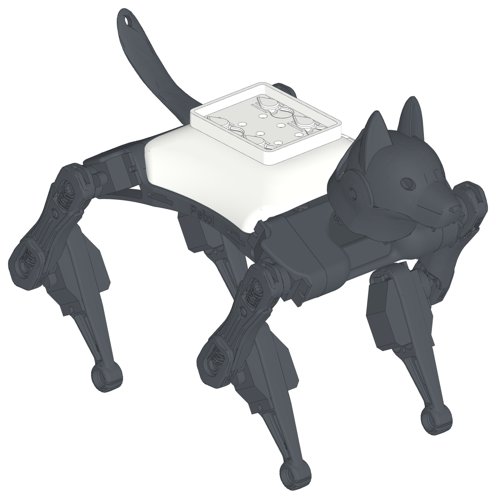
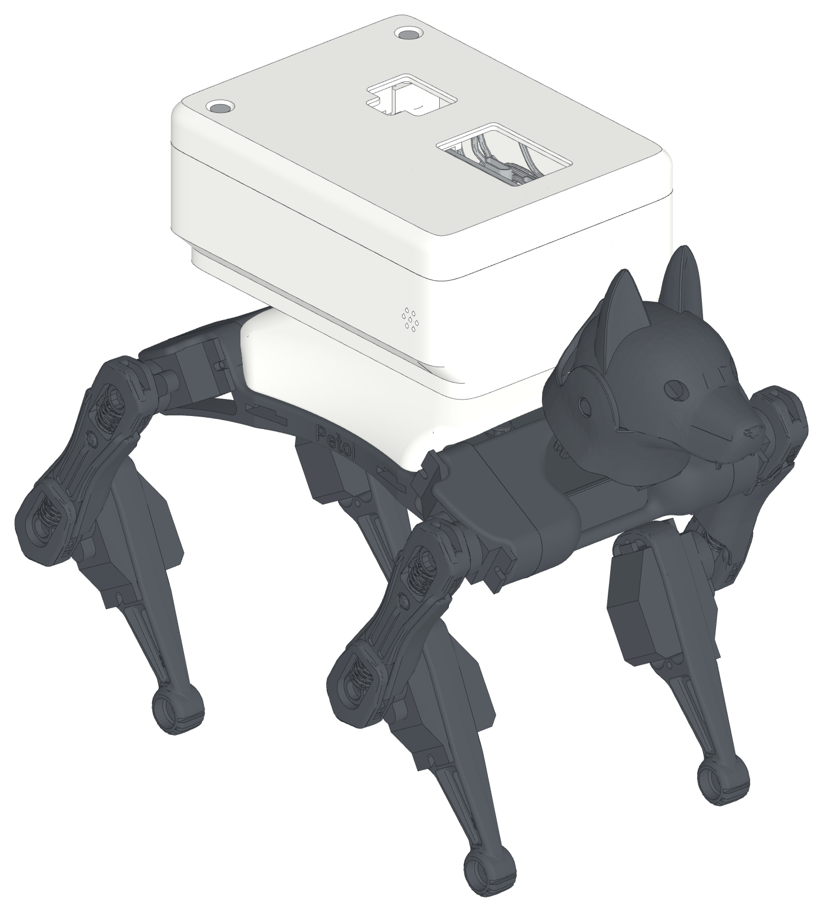
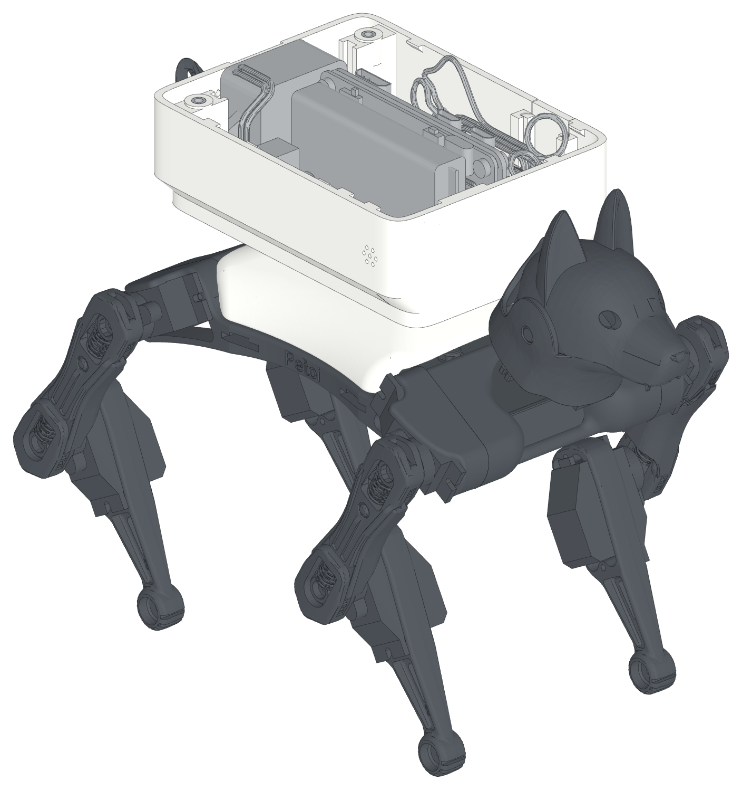

# Bittle X Pod for Pi Zero

> This repository is only the 3D model for the Bittle X hardware and software of
> [LineChef](https://github.com/LineChef). His project is
> [LineChef/BittleX](https://github.com/LineChef/BittleX), and its documentation
> site is [LineChef/react-bittlex](https://github.com/LineChef/react-bittlex).

A Raspberry Pi Zero pod for the Petoi Bittle X robot dog, and a pegged back
cover for other add-ons. It is an unofficial add-on for the Petoi Bittle X. Petoi did not make it.

**[Website and 3D viewer](https://beetlebugorg.github.io/bittlex/)** ·
[Peg interface spec (PDF)](bittle_platform/bittle_peg_spec.pdf) ·
[Pod build guide (PDF)](bittle_pi_addon/bittle_pi_addon_guide.pdf)

<picture>
  <source media="(prefers-color-scheme: dark)" srcset="bittle_platform/doc/iso/platform-dark.png">
  
</picture>

## The pegged cover

The pegged cover is the stock Petoi back cover with 4 teardrop pegs on its flat top. It
goes on the robot in place of the stock cover. The inside of the cover does
not change, so the BiBoard and the touch sensor fit as before. A notch in the
front-left edge lets the head camera plug out.

- **Tool-free mount.** Put an add-on on the pegs, slide it 7 mm forward,
  and it clicks into place. Slide it rearward, away from the head, to remove
  it closed. Two spring beams at each peg push it into a V stop, so it is
  centered and does not rattle.
- **One direction only.** The peg heads and the keyholes are teardrops.
  Turned the wrong way, an add-on does not go on.
- **Centered pegs.** The 24 x 20 mm peg pattern is on the center line of
  the robot.
- **Open interface.** The spec has every number that you need.
  [`interface.json`](bittle_platform/interface.json) has the same numbers
  for scripts and LLMs.
- **Starter plate.** Begin a new add-on from
  [`starter_plate.step`](bittle_platform/cad/starter_plate.step). It has the
  keyholes and the click springs.
- **Keep-out model.** [`keepout.stl`](bittle_platform/stl/installed/keepout.stl)
  shows the space that an add-on must keep clear: the robot, the peg heads
  and the BiBoard header.
- **Screw mount.** A heavy add-on can screw to a cover for screws: 4 M2.5
  screws at the peg places, up from inside the cover. The add-on and the
  cover clip onto the robot as one unit.

## The pod

<picture>
  <source media="(prefers-color-scheme: dark)" srcset="bittle_pi_addon/doc/iso/hero-dark.png">
  
</picture>

A Raspberry Pi with a battery, a speaker and a microphone, in one rounded box
that screws to a cover for screws.

- Raspberry Pi Zero 2 W with a PiSugar S battery (1200 mAh), on its long edge over the robot center, ports up
- NS4168 I2S amp and a 3 W speaker at the rear, sound out of the rear grille
- SPH0645 I2S microphone on the right side near the front, away from the speaker
- One-piece body: it screws to the cover empty, the cover and the body clip onto the robot, then every part goes in from the top
- Heat-set inserts hold the screws in an FDM print, and glued M2.5 nuts in a resin print
- Serial link to the BiBoard: the Dupont plugs go onto the header at the front left, and all the wires stay inside
- A slide-on top panel with two screws, and openings over the plugs, the power switch and the PiSugar button
- A door in the left wall over the BiBoard plugs: take the panel off, lift the door out, and reach the plugs from the side
- Print plates for an FDM and a resin printer are in `bittle_pi_addon/stl/plates/`

<picture>
  <source media="(prefers-color-scheme: dark)" srcset="bittle_pi_addon/doc/iso/open-dark.png">
  
</picture>

## Make your own add-on

1. Read the [peg interface spec](bittle_platform/bittle_peg_spec.pdf). It is
   3 pages.
2. Start from the starter plate, or cut the keyholes into your own plate
   with `keyhole_cutter.step` and `detent_bumps.step`.
3. Keep your part out of `keepout.stl`.
4. Print the plate face down on the bed.

For a heavy add-on, use the screw mount of the pod (rev 0.26) in
place of the keyholes. Start from
`bittle_pi_addon/stl/print/starter_plate_screw.stl`. It has 4 bosses for
M2.5 heat-set inserts, and 4 M2.5 x 4 screws hold it to
`cover_screw.stl` from inside the cover.

## Repository

| Folder | Content |
|---|---|
| [`bittle_platform/`](bittle_platform) | The pegged cover and the peg interface: spec, print files, CAD, build script |
| [`bittle_pi_addon/`](bittle_pi_addon) | The pod: build guide, print files, CAD, build script |
| [`web/`](web), `build_site.py` | The website and the 3D viewer |
| [`profiles/`](profiles) | The Cura profiles of the printers, for Printdeck builds |
| `printdeck.yml` | The printed parts, with the printer, the profile and the material of each |
| [`cura/`](cura) | The old Cura profile "Bittle X" |

The build scripts use [build123d](https://github.com/gumyr/build123d) and
[manifold3d](https://github.com/elalish/manifold). The website build needs
only Python.

## Build and print

Install the packages, and make the print files again:

```
pip install -r requirements.txt
python bittle_platform/build.py
python bittle_pi_addon/pod.py fast
python bittle_pi_addon/plates.py
```

`pod.py fast` does not write the STEP files. Use `pod.py` to write them.

`printdeck.yml` lists each printed part for Printdeck. Each FDM part has a
profile in `profiles/taz-workhorse-se/` (0.10 mm or 0.20 mm layers) and a
material (a roll). Printdeck slices the parts with these profiles. After
you approve a 3D preview, it sends them to the printer.

## License

Code: MIT. Designs and documents: CC BY 4.0. The Petoi and PiSugar models
have their own terms. See [LICENSE.md](LICENSE.md) and
[ATTRIBUTION.md](ATTRIBUTION.md).
