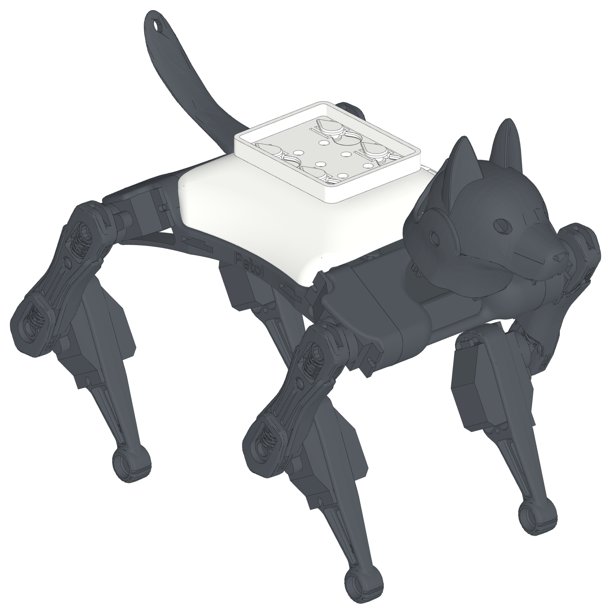
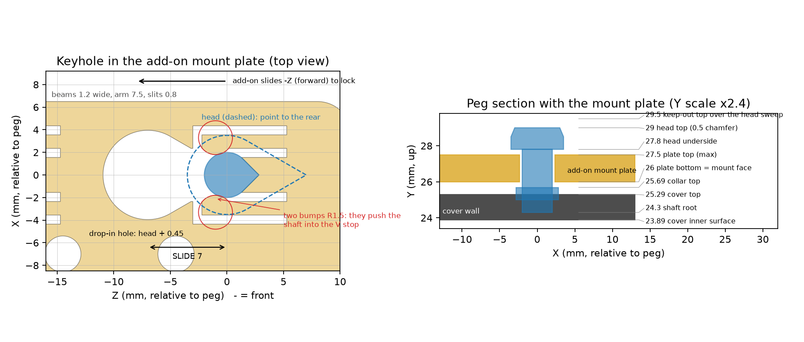
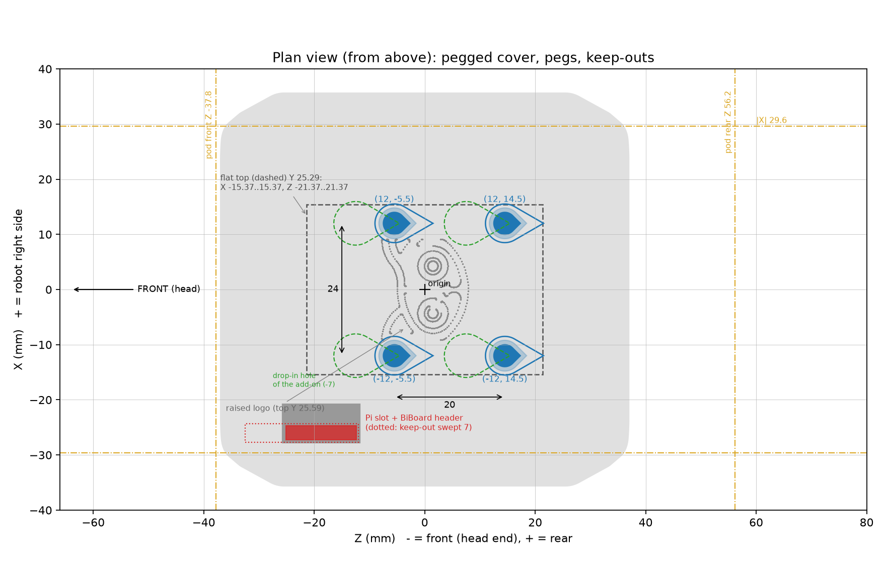

# Bittle X Pegged Cover v3.4 - Peg Interface Specification

Version 3.4, 2026-11-02. The pegged cover is the stock Petoi Bittle X back cover with 4 teardrop pegs on its top. It is an unofficial add-on interface for the Petoi Bittle X. Petoi did not make it. An add-on has a plate with 4 keyholes. Put it on the pegs, slide it 7 mm forward, and it clicks. To remove it, slide it 7 mm rearward and lift it. It comes off closed: the head is not in the way. The keyholes have the shape of the pegs, so the add-on goes on in one direction only. No tools, glue or tape are necessary. interface.json has all the numbers in machine-readable form.

Version 3.0 is not compatible with earlier versions: the pegs have a new shape and place, and the slide goes the other way. Version 3.1 adds a notch in the front edge of the cover, left side, for the Grove plug on the BiBoard (the head camera cable). Version 3.2 turns the cover model 180 deg to match the robot: the Pi slot (the BiBoard header) is at the front left, and the notch is on the front left, as on the robot. Reprint the cover: the pegs and the keyholes are the same as in 3.0. Keep add-on parts out of the plug space (GROVE_PLUG, in keepout.stl). Version 3.3 cuts the Pi slot wider toward the center (7 mm, was 3.5 mm): the BiBoard Dupont plugs did not fit. It also makes the click travel smaller (0.2 mm, was 0.28 mm): the add-on slides on and off with less force. Reprint the cover and the add-on plate. The pegs do not change. Version 3.4 adds the screw mount, for a heavy add-on: 4 M2.5 screws at the peg places, in place of the pegs (section 3).

## 1. Key numbers

| Item | Value (mm) |
|---|---|
| Frame | X lateral (+X = robot right), Y up, Z along the body (-Z = head end). Origin: center line, middle of the cover. |
| Pegs (X, Z) | (12, -5.5), (12, 14.5), (-12, -5.5), (-12, 14.5): a centered 24 x 20 rectangle |
| Peg | teardrops with the point to the rear (+Z). Head: R3.5, point 60 deg, Y 27.8 to 29. Shaft: R2, point 90 deg |
| Add-on plate | bottom at Y 26, 1.5 thick at the keyholes |
| Keyhole | drop-in hole 7 mm in front of the peg = the head teardrop + 0.45; slot 4.7 wide back to a V stop at the peg; 0.4 lead-in chamfers top and bottom |
| Fit | put the add-on on 7 mm behind its place, then slide it 7 mm forward until it clicks. Remove: slide it rearward and lift |
| Click (detent) | two 1.2 wide spring beams, one on each side of each slot, freed by 0.8 U slits (fixed at the rear end only). Bumps R1.5 at 1.01 in front of the peg, 0.2 into the shaft path. They push the shaft point into the V stop, which centers it. |
| Click force | about 2.2 N to slide on and 2.2 N to slide off (all 8 beams, PLA estimate); beam strain 0.64 % |
| Keep clear | the peg heads as they slide; the BiBoard header in the cover slot (X -27.27..-24.73, Z -25.1..-12.4, top Y 29.1) |
| Size | the pod fits in Z -37.8..56.2, \|X\| <= 29.6; outside that, check the legs and the head |

## 2. Design an add-on

1. Start from cad/starter_plate.step. It has the keyholes and the click beams.
2. Add your part on top of the plate, in the same print. You can also screw parts to the M3 holes.
3. Keep your part out of stl/installed/keepout.stl. This keeps it clear of the robot, the peg heads and the header.
4. Keep heavy parts low and near the pegs. Keep the center of mass of the add-on within 10 mm of Z 0, near X 0.
5. Keep the weight low and near the center line. The pegs carry the whole add-on.
6. For a plate of a different shape: subtract cad/keyhole_cutter.step, then add cad/detent_bumps.step. Both are in position.

## 3. Screw mount

A heavy add-on can be loose on the pegs. The screw mount holds it with 4 screws. The cover for screws (bittle_pi_addon/stl/print/cover_screw.stl) is the stock cover with no pegs. At each peg place it has a ring (R3.8) from the cover top up to Y 26, the bottom of the add-on plate. An M2.5 x 4 screw goes up through a 2.9 mm hole in the ring from inside the cover. Its head is in a 5.4 mm pocket, 0.8 mm under the plate. The add-on and the cover then clip onto the robot as one unit.

1. Put an M2.5 thread at each peg place in your plate: a heat-set insert (FDM) or a glued M2.5 nut (resin). The screw tip is at Y 29.2: the thread must reach it.
2. Start from bittle_pi_addon/stl/print/starter_plate_screw.stl: the starter plate with 4 insert bosses (3.6 mm holes, 3.9 mm deep).
3. Keep your part out of keepout.stl, as for the pegs. The slide space of the pegs is not necessary.

## 4. Printing

One Cura profile prints every part: "Bittle X" (cura/Bittle_X.curaprofile in the repository; import it in Cura). cura/install_profiles.py installs it, and a copy with the size compensation of each spool that the tolerance app measured.

| Part | Orientation | Supports |
|---|---|---|
| cover_pegs (no foot, recommended) | stand on the rear end | turn on tree supports from the bed and a 14-line brim |
| cover_pegs_foot (alternative) | stand on the rear end, foot on the bed | none: the foot is the support. Snap it off after the print. |
| starter_plate and add-ons | plate bottom on the bed | none |

| Setting | Bittle X |
|---|---|
| Layer | 0.20 (first layer 0.25) |
| Walls / infill | 3 / 20 % gyroid |
| Outer wall / inner wall / infill speed | 25 / 40 / 55 mm/s |
| Outer wall acceleration | 500 mm/s² |
| Supports / brim | off / 6 lines |
| Nozzle | 220 C (PLA) |

1. Material: PLA works. Use PETG for add-ons that you remove often or that get warm.
2. Standing on its end, the cover prints the pegs with layers along their length. This makes them strong. The shaft and collar points are down, so they need no supports.
3. The cover stands on a thin strip, and its center of mass is past that strip. The foot is a 3-layer plate with 7 fins under the leaning face. It increases the first layer from 53 to about 1000 mm². The fins touch the cover only at 21 small teeth, each one layer tall at 0.20 mm layers. Twist the foot off after the print. The no-foot print is the recommended one: the foot teeth leave a spot on the cover where they break off.
4. In add-ons, keep overhangs at 45 deg or less. Use chamfers, not round edges, on the bottom side.
5. The fits use 0.35 (slot), 0.45 (drop-in hole) and 0.3 (under the heads) clearance. Calibrate your printer if the plate does not slide on.

## 5. Files

| File | Content |
|---|---|
| stl/print/ | the parts to print, in print orientation |
| cad/starter_plate.step | the start point for an add-on |
| cad/pegs.step, keyhole_cutter.step, detent_bumps.step | the interface parts, in position (robot frame) |
| stl/installed/ | all parts and keepout.stl in the robot frame |
| interface.json / interface.py | all numbers |
| build.py, docs.py | rebuild the parts and this document (build123d, manifold3d) |

Open items: the BiBoard header height is an estimate from photos. The legs, the head and the robot balance are not modeled. The Petoi cover is a mesh, so cover_pegs is STL only.

## 6. Bittle X V2 back touch sensor

1. On a Bittle X V2, the back touch sensor is a flexible circuit that is glued to the inside of the cover top. It has touch areas on the left, the right, the center and near the tail (docs.petoi.com/extensible-modules/back-touch-sensor).
2. The peg roots stop inside the 1.4 mm wall, so the inside of the cover does not change, except at the Grove notch at the front-left edge. Move the circuit from the stock cover to cover_pegs in the same way as on the stock cover.
3. An add-on on the pegged cover covers most of the touch areas. Disable the back touch mode (serial command Xb) when an add-on is on the robot.
4. For this reason, the pegged cover has no parts under the cover top. A cover that prints flat without supports needs pegs held from inside the cover, where the circuit is. A later interface with sockets in a thicker top can avoid this.

## 7. License

The designs and this document are CC BY 4.0, and the code is MIT (Jeremy Collins). The cover, the side shoulder and the front plate are Petoi files from github.com/PetoiCamp/NonCodeFiles. Petoi publishes them without a stated license, and cover_pegs.stl is made from the Petoi cover. LICENSE.md and ATTRIBUTION.md in the repository give the details.

